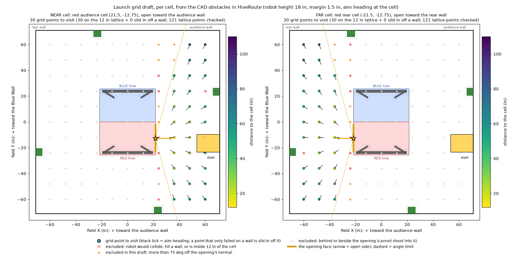

# Launch grid (2026-11-10)

The one-dimensional launch map (flywheel speed from distance only, `LaunchMap.TABLE`) is being replaced by a **two-dimensional grid** of aim and speed per launching spot. The **Launch Grid Tuner** (`opmodes/bringup/LaunchGridTuner.java`, replaced the Launch Map Tuner) collects the data; using the grid in the TeleOp is a later step. **Not yet run on the robot.**

(The picture is the design drawing, made from the same CAD keep-outs; `tools/hive/LaunchGridCheck.java` prints the real spots.)

## Which spots (`drive/LaunchGrid.java`)
One grid per hive cell: the **NEAR** cell (the cell on the start side) and the **FAR** cell (the cell opposite the start wall). Red or blue does not matter for the grids (red is blue turned 180 degrees); since 2026-11-12 the tuner ASSUMES BLUE: the usual blue start is against the rear wall facing the audience wall (-63.4, 16.0, 0 deg, `START_*` in the Dashboard; 16.5 until 2026-11-18, so the 2026-11-12 data was taken 0.5 in off the TeleOp's frame), the NEAR cell is the blue rear cell and the FAR cell the blue audience cell; the tuner used the red hive. A spot is kept only when

- it is on the cell's **open side** (the audience cell opens toward the audience wall, the rear cell toward the rear wall: nothing behind or beside the opening can score);
- it is at least `TargetLock.MIN_DISTANCE_IN` (12 in) from the cell;
- the shot is within `ANGLE_LIMIT_DEG` (75, a first guess) of the opening's normal;
- the robot **at its aim heading there** (the launcher pointed at the cell, `TargetLock.aimHeadingRad` with the launcher offset and the far-cell extra) does not overlap a foot bar, an A-frame leg or a flower stand (`HiveRoute`'s CAD keep-outs, the robot's rectangle grown by the planner's 1.5 in margin) and fits inside the walls less `WALL_MARGIN_IN` (3 in since 2026-11-12: at the rear-wall column the robot, turned to face the cell, ended 3 to 14 in short of four spots, its back corner about 1 in from the wall).

There is **no maximum distance**. A spot that fails only on a wall (turned to face the cell the corner would cross it) is slid toward the field center until it fits (at most 8 in). The lattice is centered on the field with `PITCH_IN` (12) spacing, so 30 spots for the near cell and 29 for the far. The spots are visited as a serpentine sweep, the column nearest the start first.

## How the tuner works
The robot drives to a spot (HOLD the right trigger; the route is `HiveRoute`'s, and when the router refuses a spot beside a flower stand it drives a short straight hop if that is clear, else it says BLOCKED and you drive by hand), already pointed at the cell with today's aim, and the flywheel at the launch map's speed for that distance. The operator loads, fires (Y), and trims the **angle** (D-pad left/right, 0.5 deg, the robot turns by itself) and the **speed** (D-pad up/down, 20 ticks/s) until the salvo scores. **A** takes the trims as good and goes to the next spot, **B** says no shot is possible from here, **X** goes back. Controls and the log lines are in the opmode's header and `robot-day-runbook.md` (Block F).

## Retesting spots (INIT settings, 2026-11-13)
To go back and check some spots (the picture of the map showed a few places worth a second look): in the Dashboard, before pressing Start, set **`RETEST_SPOTS`** to the spot numbers (the numbers in the `GRID POINT` lines and on the screen), a comma list with ranges, for example `8-10,22-30`, and optionally **`EXTRA_SPOTS`** to extra field positions `x,y;x,y`, for example `-42,-30;-42,-42;-30,0;-30,40;-36,54` (each must pass the grid's rules, or the INIT screen says why it is left out; they are numbered 101, 102, ...). The INIT screen lists what will be visited. The spots keep their numbers and the sweep order; `START_INDEX` then counts in the shortened list. Afterwards `python tools/launchgrid/log_to_csv.py <bringup.log> tools/launchgrid/data/<date>_BLUE_REAR_retest_<time>.csv` turns the run's `GRID POINT` lines into a CSV, and `make_table.py` (it reads every `*_BLUE_REAR_*.csv` in name order) lets the later file REPLACE the first run's rows for the same spot numbers and adds the extra spots as spots of their own.

## Re-aim and static friction (2026-11-13)
The 2026-11-12 run showed that a trim of 0.5 deg did not turn the robot: the re-aim `DriveToPose` had a 0.7 deg tolerance (the step was inside it) and no static friction term (`HEADING_kP` 1.5 per radian is 0.013 power at 0.5 deg, the drive needs about 0.1). Now `DriveToPose` has an opt-in STICTION term (`withStiction(true)`; `STICTION_ALL_LEGS` for a test run; off elsewhere, so the autos' legs are unchanged): per robot axis, only while that axis is outside the tolerance, a constant kS in the direction of the command (the DECODE approach: forward 0.065, strafe 0.11, turn 0.09, each a little under its measured dead zone) and a larger one while the robot is nearly still (start values 0.10, 0.15, 0.14; the turn's is `AimAtCell.BREAKAWAY_POWER`), dropping to the running value once it moves. The tuner uses it for the re-aim and for the hops, the re-aim tolerance is `REAIM_TOL_DEG` (0.25), and after every re-aim the screen and the log say `RE-AIM OK` or `RE-AIM STUCK` with the angle asked, the angle turned, what is left and the time. All the values are in the Dashboard. A simple simulation (a plant with a static threshold, a dead zone and a lag) settles 0.5 to 5 deg steps within 0.25 deg in 0.2 to 0.6 s with at most 0.4 deg of overshoot where the plain law and DECODE's 0.05 never move; it is a sanity check only (a plant that needs 0.16 to start is not covered by the 0.14 start value: raise `KS_TURN_START`).

## What it logs
One `GRID POINT` line per spot (the speed and its split into the launch map's speed and the trim, the aim heading and its split, the distance, how many salvos were fired, the pose; a good spot with no salvo is marked UNVERIFIED), a `FIRE` line for every salvo, `TRIM`, `DRIVE`, `ARRIVED` lines, and at the end one `GRID TABLE` line to paste. `START_INDEX` in the Dashboard continues a sweep at a later spot.

## Checks
`tools\hive\run-check.cmd` compiles and runs `LaunchGridCheck`: each grid is non-empty, every spot obeys the rules, and every hop of the sweep (from the start pose through all spots) is routable by the router or by a clear straight hop (3 hops beside flower stands are the straight kind).

## Using the grid in the TeleOp (branch `launch-grid-2d`, 2026-11-12, not run on the robot)
The data of the 2026-11-12 run (`tools/launchgrid/data/*.csv`, the blue rear cell) is turned into a table by `python tools/launchgrid/make_table.py` (generated source `drive/LaunchGridData.java`; do not edit it by hand) and read by `drive/LaunchGridMap.java`.

**What a spot holds:** where the robot actually stood (the pose reached, not the lattice point), the flywheel speed that scored, the aim **residual** (the heading that scored minus the bearing to the cell's center; the runtime aim is bearing plus residual, so it does not depend on `TargetLock`'s launcher offset or far-cell extra) and whether a shot is possible. A good spot with no salvo fired and a no-shot spot in the wall column with no salvo fired (the robot was stopped short, not tested) are left out; the hive-side no-shot spots stay.

**Lookup (`LaunchGridMap.lookup(cell, x, y)`), changed 2026-11-13: while the 2-D method is on THIS is the only source, there is no fallback to the formula or the 1-D map:**
- inside a triangle of spots: a linear blend of the speed and the residual (a no-shot spot does not contribute to the blend);
- **estimated spots:** the launching spots the Launch Grid Tuner visits that nobody measured (the spots in the wall columns the robot could not reach or that were not tested) are ESTIMATED by `make_table.py` from the nearest measured good spots (a distance-weighted local plane through the 6 nearest, clamped to the range of those neighbors plus 30 ticks/s and 3 deg) and marked estimated in the data, so the triangles reach the walls (2026-11-13: two spots in the rear-wall column of the blue rear cell, three in the seeded audience cell; the estimator tested at the outline of the measured spots: speed mean error 30 ticks/s, aim 1.6 deg);
- outside the spots: the value at the nearest point of the outline is held, at any distance (a few inches now), flagged `estimated`;
- a recorded no-shot spot, or a point whose nearest spot had no shot (the hive side of the data, where the closest spots could not shoot, and beyond it), is the `NO_SHOT` zone: the answer is still a speed and an aim (the nearby good spots'), and the zone is the warning (`NO SHOT ZONE` on the screen);
- `NO_DATA` only happens when a cell has no data at all. Backup mode (no pose) keeps the launch map's fixed distance, since there is nothing to look up. The Hive Dash looks the grid up for its LAUNCH SPOT while it drives, so the flywheel is at the grid's speed on arrival.

**The cells (2026-11-18):** both blue cells are MEASURED, each with its own spots: `BLUE_REAR` (the near cell: 30 spots, 21 good, 9 no shot) and `BLUE_AUDIENCE` (the far cell: 29 spots, 21 good, 8 no shot), from the Launch Grid Tuner runs of 2026-11-12 and 2026-11-18 (`tools/launchgrid/data/*_BLUE_REAR_*.csv` and `*_BLUE_AUDIENCE_*.csv`; a later file replaces an earlier one's row for the same spot number). The RED cells are the blue data turned 180 degrees about the field center (the residual does not change under the turn): red audience from the rear cell, red rear from the audience cell. Before 2026-11-18 the audience cell was a SEED, the rear cell's spots mirrored about X = 0 keeping the ball's path; `make_table.py` still builds that seed when there is no audience CSV, and `LaunchGridData.BLUE_AUDIENCE_SEEDED` says which it is.

**In the robot code (changed 2026-11-18, see "The launch method" below):** the grid is one of three launch methods, chosen at INIT with **gamepad 1 Y** and cycled in a run by the OPERATOR holding **left bumper + A** (guarded like the other operator tests); the default is the 1-D launch map. While the grid is the method the flywheel speed comes from the grid where it has a speed (TeleOp only: `Mechanisms.setLaunchMethod` is called by `TeleOpCompetition`; the autos never use it; a fixed distance or a Hive Dash distance keeps the launch map), and `TargetLock.turn(..., gridResidualDeg)` aims at the bearing plus the residual. The operator's gamepad 2 reports (aim nudge, speed trim) and the driver's lock nudge are added on top as before. With the grid on the competition screen shows `LAUNCH GRID ON` (the verbose screen a `Launch method` line) and `NO SHOT ZONE` while the lock is on or a launch is queued in a no-shot zone (a warning only: the launch still goes). Whatever the method, every `LAUNCH requested` line carries `METHOD ... | GRID ... | formula aim ..., grid aim ... | map ... ticks/s | EQUATION ...` so a practice session compares the three, and each change of method is a `COMMAND launch method` line; the TeleOp's sample rows have `grid_zone`, `grid_speed`, `grid_resid_deg`.

**Estimates:** `tools\\launchgrid\\dump-lattice.cmd` writes the Launch Grid Tuner's spots (`data/lattice_*.csv`, from `LaunchGrid`); `make_table.py` finds the ones with no recorded spot within 8 in and estimates them.

**Checks:** `python tools/launchgrid/make_table.py` prints a leave-one-out check (each good spot predicted from the others: 2026-11-12 data: speed rms about 39 ticks/s, aim residual rms about 3.5 deg, worst 8 deg: the operator's own trim noise is in there); `tools\launchgrid\run-check.cmd` runs `GridMapCheck` (every spot returns itself, the zones, the red rotation, the seed flag, continuity, a zone map).

## The launch method and the launch equation (2026-11-18, not run on the robot)
The question was whether the grid's data is scattered or follows something simple. It follows something simple, so there is now a third way to get the speed and the aim, and the TeleOp chooses between the three.

**Choosing:** on the TeleOp's INIT screen **gamepad 1 Y** cycles `1-D LAUNCH MAP` (the default: the launch map's speed and the formula aim, what the autos always use), `2-D LAUNCH GRID` and `LAUNCH EQUATION`. The choice is `TeleOpCompetition.LAUNCH_METHOD` (also in the Dashboard) and is kept until the app restarts. During a run the operator's **left bumper + A** cycles the method in use, for comparing them back to back in practice. The match screen shows `LAUNCH GRID ON` or `LAUNCH EQUATION ON` (nothing for the launch map), and the log a `COMMAND launch method` line at Start and at each change.

**What the data showed** (the 21 good spots of the 2026-11-12 run, blue rear cell; "leave-one-out" = each spot predicted from the other 20):

| | Speed | Aim |
|---|---|---|
| 1-D launch map and the formula, as they are | 21 ticks/s rms, worst 44 | 7.8 deg rms, worst 16 |
| 2-D launch grid, leave-one-out | 39 ticks/s rms | 3.5 deg rms, worst 8 |
| Launch equation, fit | 14 ticks/s rms, worst 24 | 2.3 deg rms, worst 4.9 |
| Launch equation, leave-one-out | 16 ticks/s rms, worst 27 | 2.6 deg rms, worst 5.5 |

- **Speed is a function of the distance only.** Adding the angle to the cell, or x and y, to the fit does not improve it. The grid does worse than a curve because it passes each spot's trim noise on (the trims were in 20 ticks/s steps).
- **Aim is not scattered, but it is not the formula.** From the -Y side of the cell (12 spots) the aim that scored was 1.3 deg left of the formula's with 1.8 deg of spread; from the +Y side (9 spots) it was 11 deg left with 2.4 deg of spread.

**The equation (`drive/LaunchEquation.java`):** speed = 1333.3 - 2.188 d + 0.07359 d^2 (d in inches, held to 25 .. 82 in; at 82 in it gives 1650, the launch map's own farthest point). Aim = the formula with the launcher offset alone (-2.5 in), aimed at a point 6.1 in deeper into the hive than the cell's point, plus 6.0 deg. The two aim numbers are a curve fit, not a measurement: they reproduce the two sides with one smooth rule. Where it is weakest: the two spots at 28 to 34 in on the +Y side (it aims 4 to 5 deg right of what scored) and the spots near straight in front (3 deg either way).

**The other cells** use the grid's rules, so the methods differ only in how they smooth the data: red is blue turned 180 deg, and the blue audience cell is the rear cell mirrored about X = 0 keeping the ball's path (the grid's seed). Only the blue rear cell is measured, for the equation as for the grid.

**No-shot zones:** the equation has none; the grid's `NO SHOT ZONE` warning shows under the equation too.

**Check:** `tools\launchgrid\run-check.cmd` now also runs `EquationCheck`: the equation against every measured spot (printed), against the seeded audience spots, the red cells, the speed curve against the launch map (at most 31 ticks/s apart over the map's range), and no jump in the aim (at most 1.3 deg per inch). It fails when the fit is worse than 20 ticks/s or 3 deg rms: after a new tuning run, refit the constants.
