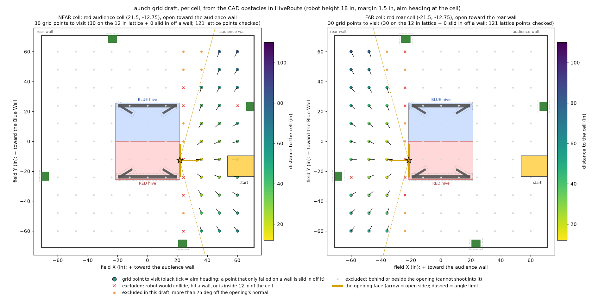

# Launch grid (2026-11-10)

The one-dimensional launch map (flywheel speed from distance only, `LaunchMap.TABLE`) is being replaced by a **two-dimensional grid** of aim and speed per launching spot. The **Launch Grid Tuner** (`opmodes/bringup/LaunchGridTuner.java`, replaced the Launch Map Tuner) collects the data; using the grid in the TeleOp is a later step. **Not yet run on the robot.**

(The picture is the design drawing, made from the same CAD keep-outs; `tools/hive/LaunchGridCheck.java` prints the real spots.)

## Which spots (`drive/LaunchGrid.java`)
One grid per hive cell: the **NEAR** cell (the cell on the start side) and the **FAR** cell (the cell opposite the start wall). Red or blue does not matter for the grids (red is blue turned 180 degrees); since 2026-11-12 the tuner ASSUMES BLUE: the usual blue start is against the rear wall facing the audience wall (-63.4, 16.5, 0 deg, `START_*` in the Dashboard), the NEAR cell is the blue rear cell and the FAR cell the blue audience cell; the tuner used the red hive. A spot is kept only when

- it is on the cell's **open side** (the audience cell opens toward the audience wall, the rear cell toward the rear wall: nothing behind or beside the opening can score);
- it is at least `TargetLock.MIN_DISTANCE_IN` (12 in) from the cell;
- the shot is within `ANGLE_LIMIT_DEG` (75, a first guess) of the opening's normal;
- the robot **at its aim heading there** (the launcher pointed at the cell, `TargetLock.aimHeadingRad` with the launcher offset and the far-cell extra) does not overlap a foot bar, an A-frame leg or a flower stand (`HiveRoute`'s CAD keep-outs, the robot's rectangle grown by the planner's 1.5 in margin) and fits inside the walls less `WALL_MARGIN_IN` (3 in since 2026-11-12: at the rear-wall column the robot, turned to face the cell, ended 3 to 14 in short of four spots, its back corner about 1 in from the wall).

There is **no maximum distance**. A spot that fails only on a wall (turned to face the cell the corner would cross it) is slid toward the field center until it fits (at most 8 in). The lattice is centered on the field with `PITCH_IN` (12) spacing, so 30 spots for the near cell and 29 for the far. The spots are visited as a serpentine sweep, the column nearest the start first.

## How the tuner works
The robot drives to a spot (HOLD the right trigger; the route is `HiveRoute`'s, and when the router refuses a spot beside a flower stand it drives a short straight hop if that is clear, else it says BLOCKED and you drive by hand), already pointed at the cell with today's aim, and the flywheel at the launch map's speed for that distance. The operator loads, fires (Y), and trims the **angle** (D-pad left/right, 0.5 deg, the robot turns by itself) and the **speed** (D-pad up/down, 20 ticks/s) until the salvo scores. **A** takes the trims as good and goes to the next spot, **B** says no shot is possible from here, **X** goes back. Controls and the log lines are in the opmode's header and `robot-day-runbook.md` (Block F).

## What it logs
One `GRID POINT` line per spot (the speed and its split into the launch map's speed and the trim, the aim heading and its split, the distance, how many salvos were fired, the pose; a good spot with no salvo is marked UNVERIFIED), a `FIRE` line for every salvo, `TRIM`, `DRIVE`, `ARRIVED` lines, and at the end one `GRID TABLE` line to paste. `START_INDEX` in the Dashboard continues a sweep at a later spot.

## Checks
`tools\hive\run-check.cmd` compiles and runs `LaunchGridCheck`: each grid is non-empty, every spot obeys the rules, and every hop of the sweep (from the start pose through all spots) is routable by the router or by a clear straight hop (3 hops beside flower stands are the straight kind).

## Using the grid in the TeleOp (branch `launch-grid-2d`, 2026-11-12, not run on the robot)
The data of the 2026-11-12 run (`tools/launchgrid/data/*.csv`, the blue rear cell) is turned into a table by `python tools/launchgrid/make_table.py` (generated source `drive/LaunchGridData.java`; do not edit it by hand) and read by `drive/LaunchGridMap.java`.

**What a spot holds:** where the robot actually stood (the pose reached, not the lattice point), the flywheel speed that scored, the aim **residual** (the heading that scored minus the bearing to the cell's center; the runtime aim is bearing plus residual, so it does not depend on `TargetLock`'s launcher offset or far-cell extra) and whether a shot is possible. A good spot with no salvo fired and a no-shot spot in the wall column with no salvo fired (the robot was stopped short, not tested) are left out; the hive-side no-shot spots stay.

**Lookup (`LaunchGridMap.lookup(cell, x, y)`), changed 2026-11-13: while the 2-D method is on THIS is the only source, there is no fallback to the formula or the 1-D map:**
- inside a triangle of spots: a linear blend of the speed and the residual (a no-shot spot does not contribute to the blend);
- **estimated spots:** the launching spots the Launch Grid Tuner visits that nobody measured (the spots in the wall columns the robot could not reach or that were not tested) are ESTIMATED by `make_table.py` from the nearest measured good spots (a distance-weighted local plane through the 6 nearest, clamped to the range of those neighbors plus 30 ticks/s and 3 deg) and marked estimated in the data, so the triangles reach the walls (2026-11-13: two spots in the rear-wall column of the blue rear cell, three in the seeded audience cell; the estimator tested at the outline of the measured spots: speed mean error 30 ticks/s, aim 1.6 deg);
- outside the spots: the value at the nearest point of the outline is held, at any distance (a few inches now), flagged `estimated`;
- a recorded no-shot spot, or a point whose nearest spot had no shot (the hive side of the data, where the closest spots could not shoot, and beyond it), is the `NO_SHOT` zone: the answer is still a speed and an aim (the nearby good spots'), and the zone is the warning (`NO SHOT ZONE` on the screen);
- `NO_DATA` only happens when a cell has no data at all. Backup mode (no pose) keeps the launch map's fixed distance, since there is nothing to look up. The Hive Dash looks the grid up for its LAUNCH SPOT while it drives, so the flywheel is at the grid's speed on arrival.

**The cells:** `BLUE_REAR` is measured. `BLUE_AUDIENCE` is a SEED: the measured spots mirrored about X = 0 keeping the ball's path (the flown launch line crosses the opening face at some y; the mirrored robot aims its launcher line at that point of the mirrored face; the speed, a function of distance, is kept). The RED cells are the blue data turned 180 degrees about the field center (the residual does not change under the turn): red audience from the rear cell, red rear from the seeded audience cell. Measure the audience cell later with the Launch Grid Tuner and rerun `make_table.py` (it reads the CSV; add the new file there).

**In the robot code:** the grid is switched on and off in the TeleOp by the OPERATOR holding **left bumper + A** (guarded like the other operator tests); `Mechanisms.USE_LAUNCH_GRID` (Dashboard, **off** by default) is only the state the TeleOp STARTS in. While it is on the flywheel speed comes from the grid where it has a speed (TeleOp only: `Mechanisms.setGridAllowed(true)` is set by `TeleOpCompetition`; the autos never use it; a fixed distance or a Hive Dash distance keeps the launch map), and `TargetLock.turn(..., gridResidualDeg)` aims at the bearing plus the residual. The operator's gamepad 2 reports (aim nudge, speed trim) and the driver's lock nudge are added on top as before. With the grid on the competition screen shows `LAUNCH GRID ON` (the verbose screen a `Launch method` line) and `NO SHOT ZONE` while the lock is on or a launch is queued in a no-shot zone (a warning only: the launch still goes). With the switch off or on, every `LAUNCH requested` / `TARGET LOCK` line carries `GRID ... | formula aim ..., grid aim ... | map ... ticks/s` so a practice session compares the grid with the formula and the map, and each toggle is a `COMMAND launch method` line; the TeleOp's sample rows have `grid_zone`, `grid_speed`, `grid_resid_deg`.

**Estimates:** `tools\\launchgrid\\dump-lattice.cmd` writes the Launch Grid Tuner's spots (`data/lattice_*.csv`, from `LaunchGrid`); `make_table.py` finds the ones with no recorded spot within 8 in and estimates them.

**Checks:** `python tools/launchgrid/make_table.py` prints a leave-one-out check (each good spot predicted from the others: 2026-11-12 data: speed rms about 39 ticks/s, aim residual rms about 3.5 deg, worst 8 deg: the operator's own trim noise is in there); `tools\launchgrid\run-check.cmd` runs `GridMapCheck` (every spot returns itself, the zones, the red rotation, the seed flag, continuity, a zone map).
